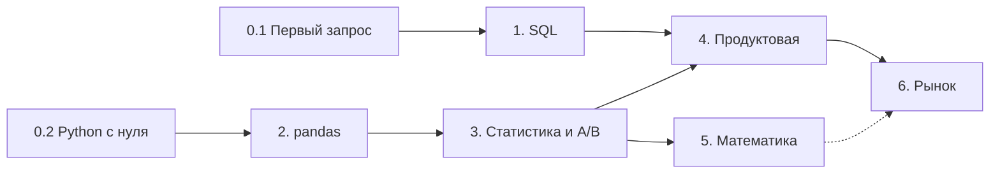

# План улучшения «Тетради аналитика»

> Архивный план от 24 сентября 2026 года. Числа, команды и отметки ниже
> отражают тот аудит: незакрытый пункт не означает, что функции сейчас
> нет. Актуальные изменения и проверки — в [ревью от 3 ноября](РЕВЬЮ-2026-11-03.md).
> Для работы и выпуска используйте текущие `AGENTS.md`, `README.md` и
> `ПРОГРЕСС.md`; этот документ сохранён как история решений.

Дата аудита: 24.09.2026. Проверено по исходникам и на живом сайте (десктоп и телефон 375 px).

Курс уже зрелый: 42 урока в семи модулях, SQL и Python запускаются в браузере, есть повторение по интервалам, словарь, офлайн-режим и перенос прогресса. План — не переделка, а доводка до уровня «ученик не теряется ни на одном шаге».

## Правила для исполнителя

- Перед работой прочитать `README.md` и `ПРОГРЕСС.md`: там устройство проекта, правила оформления (один акцент, радиусы 13/7 px, одна анимация `ink-in`), тон текстов и проверенные числа.
- Не менять `id` уроков и не вставлять элементы в середину массивов `cards`, `steps`, `practicum.steps`: позиция и `id` — ключи прогресса ученика. Новое дописывать в конец.
- Все новые числа в уроках проверять запуском на учебной базе.
- Перед сборкой прогонять: `node инструменты/checkcards.js --require m0 m1 m2 m3 m4 m5 m6`, `node инструменты/checkterms.js`, `node инструменты/checksteps.js <урок>`.
- После изменений: сменить `VERSION` в `sw.js`, выполнить `python3 build.py`.
- Проверять правки на `python3 инструменты/devserver.py 8779`.

## 1. Где проект сейчас

| Модуль | Уроков | Типы уроков | Слов теории на урок |
| --- | --- | --- | --- |
| 0. Старт | 2 | пошаговые SQL и Python | 600–720 |
| 1. SQL для аналитика | 8 | 7 SQL, 1 текстовый | 400–970 |
| 2. Python и pandas | 7 | Python | 450–730 |
| 3. Статистика и A/B | 7 | 6 Python, 1 текстовый | 440–1070 |
| 4. Продуктовая аналитика | 7 | 2 SQL, 2 Python, 3 текстовых | 420–1210 |
| 5. Математика | 5 | 4 Python, 1 текстовый | 780–900 |
| 6. Выход на рынок | 6 | 1 SQL, 1 Python, 4 текстовых | 530–760 |

В каждом обычном уроке: теория, 8–12 карточек, основная задача с автопроверкой и тремя подсказками, 5 задач тренажёра, 5–7 вопросов самопроверки, 3–6 ссылок, заметки. Всего 257 вопросов, 441 карточка, 199 задач тренажёра.

Стек: чистый JS без фреймворка (`app.js` — 3 429 строк), CodeMirror, sql.js, Pyodide с pandas, сборка в один HTML через `build.py`, выкладка на GitHub Pages.

## 2. Главные проблемы

| # | Проблема | Чем мешает ученику |
| --- | --- | --- |
| 1 | В теории ни одной схемы или графика: 0 `svg`/`img` во всех 42 уроках | JOIN, окна, ЦПТ, доверительный интервал, ROC-кривая, воронка и когорты объясняются только текстом и таблицами |
| 2 | Python не рисует графики: в уроке 2.5 «Визуализация» задача — текстовая гистограмма из `#` | Навык «построить график в matplotlib/seaborn», который ждут на тестовом, не тренируется совсем |
| 3 | 199 задач тренажёра без редактора и проверки — только «показать решение» | Самая большая часть практики не даёт обратной связи; соблазн подсмотреть выше, чем в основной задаче |
| 4 | Порядок уроков в модулях 1 и 3 идёт против зависимостей: окна (1.2) раньше GROUP BY/HAVING (1.3), доверительный интервал (3.1) раньше ЦПТ (3.2) | Ученик с нуля встречает понятия до их объяснения |
| 5 | На телефоне в шапке скрыты «К собеседованию», «Конспект» и «Словарь» (`.hdr-nav` — `display: none`), замены нет | Три главные справочные страницы недоступны из урока на мобильном |
| 6 | Обещано «≈ 2 часа» на урок, а теории 400–1200 слов (5–8 минут чтения) | Объём покрытия темы неравный: сложные темы (3.1, 4.1, 1.8) получили меньше всего текста |

Ещё: счётчик `miss` (сколько раз ученик ошибся) уже пишется, но страницы «Мои ошибки» нет — данные собираются и никак не используются.

## 3. Дизайн

Визуальная система «тетрадь + наставник на полях» удачная, её нужно сохранить. Доработки — про наглядность и мобильный экран.

### Наглядность теории

- **Схемы в SVG в стиле тетради** (тонкая линия, фиолетовая ручка, тёмная тема через `currentColor`). Минимум одна на урок, первая очередь — 15 схем из раздела 5.
- **Анимированные «песочницы»** для 4–5 самых абстрактных тем: ползунок размера выборки в ЦПТ, порог классификации на ROC, MDE ↔ размер выборки, рамка окна `ROWS BETWEEN`, шаг градиентного спуска. Данные уже есть в «ключевых числах» `ПРОГРЕСС.md`.
- **Таблицы «было → стало»** из практикумов 1.2–1.4 перенести в теорию JOIN, подзапросов и дат — компонент уже написан.

### Урок как лонгрид

- Сейчас порядка 7 200 px высоты на десктопе (теория 4 600, самопроверка 2 100). Добавить в липкой панели разделов отметки «пройдено» (галочка у Теория, Задача, Самопроверка) и тонкую полосу прогресса чтения.
- Схему базы (сейчас спрятана в свёрнутом «Входные данные») сделать боковой шпаргалкой рядом с редактором на широком экране и выдвижной нижней шторкой на телефоне; клик по столбцу вставляет его в редактор.
- «Ожидаемый результат» рядом с выводом сейчас показывает готовые числа. Дать выбор: по умолчанию только структура (столбцы + число строк), числа — по кнопке.

### Телефон

- Вернуть навигацию: кнопка-меню в шапке или нижний таб-бар «Курс · Повторение · Словарь · Собеседование».
- Набирать SQL на телефоне тяжело: добавить панель быстрых клавиш над клавиатурой (`SELECT`, `FROM`, `WHERE`, `GROUP BY`, `(`, `)`, `,`, `*`, `'`, имена таблиц).
- Для телефона сделать режим «в дороге»: только теория, карточки и самопроверка, без редактора. Повторение — самый мобильный сценарий.
- В таблицах теории и в блоке `FROM → WHERE → GROUP BY` текст уходит за правый край без подсказки о прокрутке: добавить тень-градиент на краю или перестраивать таблицу в карточки уже 480 px.

### Доступность

- Рукописный Bad Script на телефоне читается хуже всего: оставить его для реплик до 12 слов, длинные переводить в курсив Literata.
- Прогнать axe/Lighthouse: контраст серых подписей (`--ink-2`) на кремовом фоне, фокус с клавиатуры в карточках и квизах.
- Шрифты с Google Fonts (4 семейства) офлайн не кешируются надёжно и недоступны в части сетей — положить `woff2` собственными файлами с подмножеством кириллицы.

## 4. Клиентский опыт

Главное — превратить пассивную практику в активную и дать ученику ответ на вопрос «что мне делать сегодня и готов ли я».

### Практика

1. **Тренажёр с автопроверкой.** У каждой из 199 задач уже есть `solution` — эталон можно считать автоматически, запуская решение на той же базе (как делает `checksteps.js`). Дать редактор, «Проверить» и статус решённости. Решение открывать после попытки или с подтверждением.
2. **Понятные ошибки проверки.** Вместо «не совпало» — диагноз: «строк больше на 12 — похоже на размножение при JOIN», «не хватает канала partner — проверьте тип JOIN», «столбец revenue отличается в 3-й строке». Подсветка расхождений в самой таблице.
3. **Графики в Python.** Перехватывать `plt.show()` в Pyodide и выводить PNG в блок вывода. Проверять не картинку, а объект графика: тип, данные линий, подписи осей, заголовок-вывод.
4. **Режим «песочница»** — отдельная страница со свободным редактором SQL/Python над базой «Дельта Маркет» и схемой сбоку: ученик пробует свои гипотезы без привязки к уроку.

### Прогресс и повторение

1. **Страница «Мои ошибки»** на уже собираемом `miss`: топ вопросов и карточек, где ученик ошибался, сгруппированные по теме, с кнопкой «повторить раздел теории».
2. **Карта навыков** вместо счётчика «0 из 42»: 12–15 навыков (JOIN, окна, когорты, t-тест, дизайн A/B…) с уровнем из задач, тренажёра и повторения. Это и есть ответ «готов ли я к собеседованию».
3. **План на день** на главной: «Сегодня: 8 карточек на повторение (5 мин) + урок 1.3 до задачи (40 мин)». Ученик выбирает темп (30 / 60 / 120 мин в день) и видит прогноз даты окончания.
4. **Входной тест на 10 минут** (по 3–4 вопроса SQL, Python, статистика) с рекомендацией стартового урока и возможностью зачесть модуль экстерном — сейчас опытный ученик и новичок идут по одной линии.
5. **Итоговый тест модуля** из вопросов всех его уроков вперемешку и сведение «модуль закрыт» — явная точка перехода.

### Собеседование

1. **Режим «лайв-собеседование»:** случайные 3 SQL-задачи + 5 теоретических вопросов + 1 продуктовый кейс, таймер 45 минут, без подсказок, итоговый отчёт.
2. **Ответ вслух:** в карточках собеседования кнопка «записать ответ» (MediaRecorder, хранение локально) и сравнение с эталоном — на интервью нужно говорить, а не выбирать вариант.

### Мелочи, которые снимают трение

- Индикатор загрузки Python с процентами и фоновая предзагрузка Pyodide с урока 0.2 (первый запуск сейчас 15–40 секунд).
- История запусков в редакторе (вернуться к прошлой версии запроса).
- Перенос прогресса без файла: 8-символьный код или QR для перехода с ноутбука на телефон (вариант без сервера — сжатый прогресс в QR).
- Кнопка «сообщить об ошибке в уроке» с id урока и блока (форма или issue на GitHub) — единственный канал обратной связи с учениками.

## 5. Рациональность материала

Материал плотный и проверенный, но порядок и объём уроков стоит пересобрать по зависимостям понятий.

### Новый порядок модулей 1 и 3

| Сейчас | Предлагаю | Почему |
| --- | --- | --- |
| 1.1 JOIN → 1.2 Окна → 1.3 GROUP BY/HAVING | 1.1 GROUP BY/HAVING → 1.2 JOIN → 1.3 Подзапросы → 1.4 CTE → 1.5 Окна → 1.6 Даты | Окна строятся поверх агрегаций и часто внутри CTE; сейчас CTE (1.4) идёт после окон |
| 3.1 Доверительный интервал → 3.2 Распределения и ЦПТ | 3.1 Распределения и ЦПТ → 3.2 Доверительный интервал | Интервал опирается на ЦПТ и стандартную ошибку |
| 1.7 ClickHouse в середине SQL-модуля | После проекта 1.8 или в модуль 6 | Это надстройка, а не база, и урок текстовый |

Перестановка ломает ключи прогресса, если менять `id`. Безопасный путь уже есть в коде: оставить `id` (`m1l3` остаётся `m1l3`), менять только порядок и номера в `lessons.js`, как сделано полем `before` для 0.2. После перестановки перечитать вступления уроков: фразы вроде «в прошлом уроке мы…» соврут.

### Карта зависимостей

Показать эту карту на главной и явно пометить модуль 5 как необязательный для первого оффера (пунктир). Ученик с дедлайном увидит короткий путь.

### Два темпа прохождения

- **Быстрый (≈ 4 недели):** 0 → 1 → 2 → 3.1–3.4, 3.7 → 4 → 6. Для тех, у кого уже назначены собеседования.
- **Полный (2–3 месяца):** всё, как сейчас.

### Выровнять объём

- Проектные уроки 1.8, 2.7, 3.7 и стартовый кейс 4.1 самые короткие (400–590 слов). Добавить в них разобранный пример хорошего и плохого итога проекта и чек-лист сдачи.
- Длительность «≈ 2 часа» сейчас стоит почти у всех уроков. Считать её по факту: по медиане времени из таймера урока, который уже пишет `days`.
- В уроках по 12 карточек и 7 вопросов часть фактов проверяется дважды. Проверить скриптом пересечения карточек и вопросов и развести их: карточки — факты и определения, вопросы — применение в ситуации.

### Схемы первой очереди (15 штук)

| Урок | Схема |
| --- | --- |
| 0.1 / 1.x | Порядок выполнения запроса FROM → WHERE → GROUP BY → HAVING → SELECT → ORDER BY |
| JOIN | Соединение строк двух таблиц (не круги Эйлера) и размножение строк |
| Окна | PARTITION BY и рамка ROWS BETWEEN на полосе строк |
| Даты | Когортная таблица «треугольник» |
| 2.1 | split → apply → combine для groupby |
| 2.3 | Ящик с усами и граница IQR 7 445,78 |
| 2.4 | Сырой ряд против resample и скользящего среднего |
| 3.1–3.2 | ЦПТ: распределение средних при n = 5, 30, 200; интервал как «100 выборок» |
| 3.4 | Два колокола: α, β, мощность, MDE |
| 3.5 | Рост FWER с числом метрик: 5 → 64,2% |
| 4.2 | Воронка 220 → 206 → 175 → 121 → 64 |
| 4.3 | Кривые удержания по когортам и парадокс Симпсона по каналам |
| 5.1–5.2 | Линия регрессии и остатки «воронкой» (разброс 431 → 8 641) |
| 5.3 | ROC-кривая, AUC 0,86 и пороги |
| 5.5 | Спуск по параболе при шаге 0,5 и 1,1 |

## 6. Полнота материала

Самая крупная дыра — BI: сам курс пишет на главной, что дашборд требуют в ~60% вакансий, а практики в BI-инструменте нет (4.6 — текстовый урок). Поиск по текстам уроков показал ещё несколько тем, которые спрашивают на junior-интервью, но в курсе их нет или они упомянуты вскользь.

| Тема | Что сейчас | Формат | Куда |
| --- | --- | --- | --- |
| BI на практике (DataLens / Superset) | 14 упоминаний DataLens, ни одного задания | пошаговый гайд со скриншотами + CSV базы для загрузки + сдача ссылкой на дашборд по чек-листу | новый урок после 4.6 |
| Excel / Google Sheets | 10 упоминаний как сравнение | сводные, ВПР/XLOOKUP, условное форматирование на тех же данных; тестовые часто дают в xlsx | модуль 0 или 6 |
| Строки и NULL в SQL | `LIKE` — 0 упоминаний | LIKE, строковые функции, UNION vs UNION ALL, COALESCE/NULLIF в одном уроке | модуль 1 |
| Производительность запроса | `EXPLAIN` — 0 | план запроса, индексы, почему `SELECT *` дорого — врезка в урок ClickHouse | 1.7 |
| Теория вероятностей | Байес — 1 упоминание | условная вероятность, формула Байеса, комбинаторика — типовые задачи с собеседований | новый урок в начале модуля 3 |
| Ratio-метрики в A/B | дельта-метод — 0, CUPED — 3 упоминания | бутстрап для среднего чека, идея дельта-метода и CUPED на пальцах | врезка в 3.6 или новый 3.x |
| Дерево метрик | 0 упоминаний | декомпозиция выручки = пользователи × конверсия × чек, North Star, приоритизация гипотез ICE/RICE | 4.1 (расширить) |
| Git и Jupyter в рабочем цикле | упоминаются в портфолио | чек-лист: поставить Jupyter, выложить EDA из 2.7 на GitHub, оформить README | 6.2 |
| Коммуникация с заказчиком | есть тикеты и записка 4.7 | как уточнять расплывчатую задачу: ученик сам задаёт вопросы «Ире из маркетинга» перед решением | тикеты проектных уроков |

### Форматы, которых не хватает

- **Сквозной финальный проект:** один тестовый как в компанию — SQL-выгрузка → pandas → A/B → дашборд → записка, на новом датасете с дедлайном 3–5 дней. Итог идёт прямо в портфолио.
- **Второй датасет для собеседования.** Все задачи на «Дельта Маркет» и журнале приложения: к модулю 6 ученик знает схему наизусть. Нужна незнакомая база (такси, стриминг, банк), чтобы тренировать чтение чужой схемы.
- **Банк SQL-задач по уровням** (50–100 штук, автопроверка) с фильтром по теме — аналог LeetCode внутри курса. Часть собирается из уже готовых 199 задач тренажёра.
- **Шпаргалки на одну страницу** для печати (SQL, pandas, статистика, метрики): печатный стиль `@media print` уже есть.

## 7. Дорожная карта

Четыре этапа: сначала дешёвые правки с большим эффектом, потом практика, потом новый контент.

### Этап 1. Быстрые победы (≈ 1 неделя)

- [x] Мобильная навигация: меню или нижний таб-бар
- [x] Перестановка уроков модулей 1 и 3 без смены `id` + вычитка переходов между уроками
- [x] Скрывать числа в «ожидаемом результате» до нажатия
- [x] Страница «Мои ошибки» на собранном `miss`
- [x] Карта зависимостей на главной и метка «необязательный» у модуля 5
- [x] Свои шрифты вместо Google Fonts, прогон Lighthouse/axe

### Этап 2. Активная практика (≈ 2–3 недели)

- [x] Тренажёр с редактором и автопроверкой для 199 задач (эталон считается из `solution`)
- [x] Диагностические сообщения проверки и подсветка расхождений
- [ ] matplotlib в Pyodide + переделка урока 2.5 на настоящие графики
- [ ] Схема базы сбоку от редактора, панель клавиш на телефоне
- [ ] Песочница SQL/Python

### Этап 3. Наглядность и навигация по обучению (≈ 3 недели)

- [ ] 15 SVG-схем первой очереди, затем по одной на каждый оставшийся урок
- [ ] 4–5 интерактивных песочниц (ЦПТ, MDE, ROC, рамка окна, градиентный спуск)
- [ ] Входной тест, план на день, два темпа прохождения
- [ ] Карта навыков и итоговые тесты модулей

### Этап 4. Новый контент (≈ 4–6 недель)

- [ ] Урок BI на практике (DataLens)
- [ ] Урок теории вероятностей
- [ ] Урок строк/NULL/UNION в SQL; расширение 4.1 деревом метрик; ratio-метрики в A/B
- [ ] Excel/Sheets для аналитика
- [ ] Второй датасет и режим «лайв-собеседование»
- [ ] Сквозной финальный проект и шпаргалки для печати

### Как понять, что стало лучше

Сейчас курс не знает, где ученики бросают занятия. До этапа 2 стоит поставить анонимную без cookie аналитику (например, GoatCounter) и смотреть три числа: долю дошедших до модуля 2, долю решённых основных задач без показа решения, урок с наибольшим оттоком. Для аналитического курса это ещё и готовая воронка для разбора в уроке 4.2.
